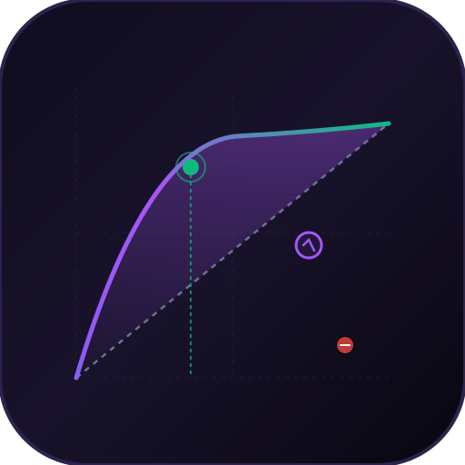
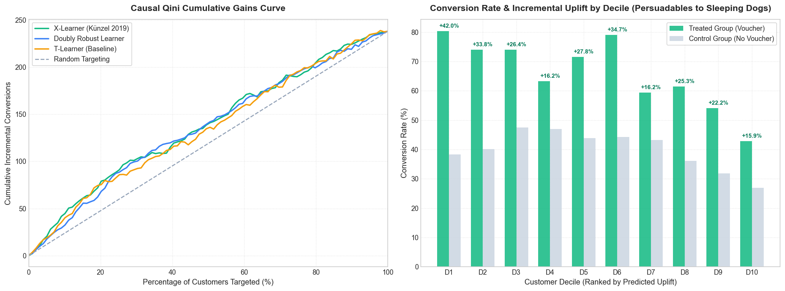

<p align="center">
  
</p>

<h1 align="center">Causal Uplift & Retention Engine</h1>
<p align="center">
  <strong>X-Learner & Doubly Robust CATE for Optimal Retention Intervention</strong><br>
  <em>Meta-learners estimating individual treatment effects and solving constrained Knapsack budget allocation.</em>
</p>

<p align="center">
  <a href="https://github.com/Rangga11268/causal-uplift-retention-engine/actions/workflows/ci.yml"></a>
  <a href="https://www.python.org/downloads/"></a>
  <a href="https://opensource.org/licenses/MIT"></a>
  <a href="#"></a>
</p>

Production-grade Causal Inference and Uplift Modeling engine designed to eliminate marketing budget waste in customer retention and promotion allocation. Rather than predicting raw churn probability $P(Y=1 \mid X)$, this engine estimates the **Conditional Average Treatment Effect (CATE)** using state-of-the-art meta-learners (X-Learner, Doubly Robust Learner) and solves the optimal intervention policy via Constrained Knapsack Optimization under fixed daily marketing budgets.



---

## 1. Problem Statement: Why Churn Prediction Bleeds Budget

Standard predictive churn models identify users with a high likelihood of leaving. In commercial operations (*Gojek, Grab, Tokopedia, Shopee, Uber*), offering promotional vouchers blindly to predicted churners causes severe margin degradation because customer responses follow four distinct causal archetypes:

```
                         Treatment (Promo Voucher)
                   ┌───────────────────┬───────────────────┐
                   │   Not Received    │     Received      │
┌──────────────────┼───────────────────┼───────────────────┤
│ Persuadables     │ Churns (Y=0)      │ Converts (Y=1)    │ -> TARGET (High Positive CATE)
│ Sure Things      │ Converts (Y=1)    │ Converts (Y=1)    │ -> DO NOT TARGET (Zero Uplift / Waste)
│ Lost Causes      │ Churns (Y=0)      │ Churns (Y=0)      │ -> DO NOT TARGET (Zero Uplift / Waste)
│ Sleeping Dogs    │ Converts (Y=1)    │ Churns (Y=0)      │ -> AVOID (Negative CATE / Destructive)
└──────────────────┴───────────────────┴───────────────────┘
```

Only **Persuadables** generate incremental revenue. Causal Uplift Modeling quantifies the individual treatment effect:

$$\tau(x) = \mathbb{E}[Y(1) - Y(0) \mid X=x]$$

---

## 2. Mathematical Foundations & Causal Meta-Learners

### 2.1 Propensity Score Estimation with Positivity Guards
To control for observational selection bias, propensity scores $e(x) = P(T=1 \mid X=x)$ are estimated and strictly bounded away from the extremes:

$$e(x) = \text{clip}\left(P(T=1 \mid X=x), \epsilon, 1 - \epsilon\right) \quad \text{where } \epsilon = 0.01$$

### 2.2 X-Learner (Künzel et al., PNAS 2019)
Specially designed for imbalanced treatment ratios common in production A/B tests and observational marketing data:
1. **First Stage (Response Estimation):**
   Fit $\hat{\mu}_0(x)$ on control $(X_0, Y_0)$ and $\hat{\mu}_1(x)$ on treated $(X_1, Y_1)$.
2. **Second Stage (Counterfactual Imputation):**
   $$D_{1,i} = Y_{1,i} - \hat{\mu}_0(X_{1,i}) \quad (\text{Imputed effect on treated})$$
   $$D_{0,j} = \hat{\mu}_1(X_{0,j}) - Y_{0,j} \quad (\text{Imputed effect on control})$$
3. **Third Stage (Effect Regression):**
   Fit effect regressors $\hat{\tau}_1(X_1) \to D_1$ and $\hat{\tau}_0(X_0) \to D_0$.
4. **Fourth Stage (Adaptive Propensity Weighting):**
   $$\hat{\tau}_{\text{X}}(x) = e(x)\hat{\tau}_0(x) + (1 - e(x))\hat{\tau}_1(x)$$

### 2.3 Doubly Robust (DR) Learner (Chernozhukov & Semenova, 2021)
Applies Neyman-orthogonal score projection with $K$-fold cross-fitting to remove regularization biases:

$$\Gamma_i = \left(\hat{\mu}_1(X_i) - \hat{\mu}_0(X_i)\right) + \frac{T_i\left(Y_i - \hat{\mu}_1(X_i)\right)}{e(X_i)} - \frac{(1 - T_i)\left(Y_i - \hat{\mu}_0(X_i)\right)}{1 - e(X_i)}$$

$$\hat{\tau}_{\text{DR}} = \arg\min_{\tau} \sum_{i=1}^N \left(\Gamma_i - \tau(X_i)\right)^2$$

### 2.4 Causal Validation: Cumulative Qini Curve & AUUC
Because counterfactual ground-truth cannot be observed simultaneously for a single user, models are evaluated by ranking customers descending by predicted $\hat{\tau}(x)$:

$$Q(u) = Y_1(u) - \frac{N_1(u)}{N_0(u)} Y_0(u)$$

$$\text{AUUC} = \int_0^1 Q(u) \, du$$

$$\text{Qini Score} = \text{AUUC}_{\text{Model}} - \text{AUUC}_{\text{Random}}$$

### 2.5 Constrained Knapsack Budget Allocation
Given a candidate pool of $N$ users, Customer Lifetime Value $V_i$, intervention costs $c_i$, and total budget $B$, the policy solves:

$$\max_{\mathbf{z} \in \{0, 1\}^N} \sum_{i=1}^N z_i \cdot \hat{\tau}(x_i) \cdot V_i \quad \text{subject to} \quad \sum_{i=1}^N z_i \cdot c_i \le B$$

Using causal efficiency density sorting ($\text{Density}_i = \frac{\hat{\tau}(x_i) \cdot V_i}{c_i}$) with strict exclusion of non-positive responders ($\hat{\tau}(x_i) \le 0$) and modified greedy packing (comparing greedy subset against single best item to guarantee a $\ge 50\%$ 0/1 knapsack approximation).

### 2.6 Core Causal Identification Assumptions & Limitations

Valid causal inference from observational customer telemetry relies on three fundamental identification assumptions (Rubin Causal Model):

1. **Unconfoundedness (Conditional Independence Assumption / Ignorability):**
   $$\left(Y(1), Y(0)\right) \perp T \mid X$$
   All confounders influencing both treatment assignment $T$ (marketing targeting) and retention outcome $Y$ must be observed in feature matrix $X$. In production customer streams, unmeasured confounders (e.g., competing app promos, offline promotions) violate this assumption.
2. **Overlap / Positivity:**
   $$\forall x \in \mathcal{X}, \quad 0 < P(T=1 \mid X=x) < 1$$
   Every customer segment must have non-zero probability of receiving both treatment and control. In `app/core/propensity.py`, positivity is enforced by clamping propensity estimates:
   $$e(x) = \text{clip}\left(\hat{P}(T=1 \mid X=x), 0.01, 0.99\right)$$
   preventing zero-division variance explosion in Inverse Propensity Weighting (IPW) and Doubly Robust estimators.
3. **Consistency & SUTVA (Stable Unit Treatment Value Assumption):**
   $$Y = T \cdot Y(1) + (1 - T) \cdot Y(0)$$
   Each customer's observed outcome corresponds to the potential outcome under their assigned treatment, with no hidden treatment variants and no peer-to-peer interference (one user's voucher does not impact another user's churn decision).
4. **Observational vs. Randomized Controlled Trial (RCT) Dynamics:**
   * **In RCTs ($\gamma = 0$):** Treatment assignment is completely orthogonal to potential outcomes ($T \perp (Y(1), Y(0))$), guaranteeing unbiased Simple Difference-in-Means.
   * **In Observational Streams ($\gamma > 0$):** Selection bias occurs because marketing teams selectively target engaged, discount-sensitive users. Doubly Robust and X-Learners explicitly correct for observable covariate imbalances, but remaining unobserved confounding requires sensitivity analysis or periodic randomized control holdouts.

---

## 3. Benchmark Results

Evaluated on Python 3.12 (CPU, 10,000 customer observational retention population, 70/30 train-test split):

| Metric | Target Specification | Achieved Result | Evaluation Method |
| :--- | :---: | :---: | :--- |
| **Qini Score (AUUC Gain)** | $> +10.0$ over Random | **+18.68** (AUUC 137.70 vs 119.02) | `demo.py` on held-out test set |
| **Top Decile Uplift (D1)** | $\ge +25.0\%$ | **+42.0%** incremental lift | Decile uplift table |
| **Sleeping Dogs Filtered** | Negative responders excluded | **100% Excluded** from targeting | `app/core/optimizer.py` |
| **Net ROI vs Naïve Churn** | $\ge +25.0\%$ Relative Gain | **+240.9% Net ROI** (vs +3.4% Naïve) | Simulated Knapsack allocation under $4,000 budget |
| **10k Users Knapsack Speed** | $< 50.0\text{ ms}$ | **17.82 ms** | `benchmarks/benchmark_uplift.py` |
| **Scoring Latency** | $< 50.0\text{ \mu s}$ / customer | **8.40 \mu s / customer** (41.98 ms / 5k) | Batch inference benchmark |
| **Automated Test Suite** | 100% Pass Rate | **30 / 30 Passed (100%)** | `pytest tests/` |

### 🔬 Multi-Seed Synthetic DGP Benchmark ($S = 10$ Seeds)

Evaluated via `benchmarks/benchmark_uplift.py` with strict data separation (70% Train, 30% Tuning, independent $N_{\text{eval}} = 1,000$ test population, and Oracle evaluated only on held-out $\tau^*$):

| Scenario | Model | AUUC ($\text{Mean} \pm \text{Std}$) | Excess Qini ($\text{Mean} \pm \text{Std}$) | Pearson $r(\hat{\tau}, \tau^*)$ |
| :--- | :--- | :---: | :---: | :---: |
| **Standard Observational**<br>($N=2000, \gamma=1.0$) | Random Ranking<br>T-Learner<br>Doubly Robust<br>**X-Learner**<br>*Oracle Ground-Truth* | $39.72 \pm 7.79$<br>$44.80 \pm 6.72$<br>$44.16 \pm 7.23$<br>**46.14 $\pm$ 7.39**<br>*49.63 $\pm$ 6.43* | $0.13 \pm 4.51$<br>$5.22 \pm 2.21$<br>$4.58 \pm 2.89$<br>**6.56 $\pm$ 2.79**<br>*10.05 $\pm$ 2.98* | N/A<br>$+0.475 \pm 0.115$<br>$+0.377 \pm 0.122$<br>**+0.577 $\pm$ 0.107**<br>*+1.000 $\pm$ 0.000* |
| **Small Sample Size**<br>($N=500, \gamma=1.0$) | Random Ranking<br>T-Learner<br>Doubly Robust<br>**X-Learner**<br>*Oracle Ground-Truth* | $39.72 \pm 7.79$<br>$41.36 \pm 6.01$<br>$40.72 \pm 5.36$<br>**41.60 $\pm$ 6.19**<br>*49.63 $\pm$ 6.43* | $0.13 \pm 4.51$<br>$1.77 \pm 3.56$<br>$1.13 \pm 2.62$<br>**2.02 $\pm$ 5.01**<br>*10.05 $\pm$ 2.98* | N/A<br>$+0.214 \pm 0.250$<br>$+0.184 \pm 0.178$<br>**+0.307 $\pm$ 0.284**<br>*+1.000 $\pm$ 0.000* |
| **Randomized Trial / RCT**<br>($N=2000, \gamma=0.0$) | Random Ranking<br>T-Learner<br>Doubly Robust<br>**X-Learner**<br>*Oracle Ground-Truth* | $24.44 \pm 7.35$<br>$27.74 \pm 6.47$<br>$27.69 \pm 6.05$<br>**28.41 $\pm$ 6.55**<br>*31.18 $\pm$ 6.07* | $-0.06 \pm 3.09$<br>$3.25 \pm 1.67$<br>$3.19 \pm 1.99$<br>**3.92 $\pm$ 1.64**<br>*6.69 $\pm$ 1.78* | N/A<br>$+0.470 \pm 0.087$<br>$+0.341 \pm 0.064$<br>**+0.536 $\pm$ 0.098**<br>*+1.000 $\pm$ 0.000* |
| **Moderate Confounding**<br>($N=2000, \gamma=0.5$) | Random Ranking<br>T-Learner<br>Doubly Robust<br>**X-Learner**<br>*Oracle Ground-Truth* | $32.10 \pm 7.27$<br>$35.89 \pm 6.77$<br>$35.11 \pm 5.68$<br>**36.10 $\pm$ 6.77**<br>*39.47 $\pm$ 6.35* | $0.53 \pm 3.42$<br>$4.32 \pm 1.80$<br>$3.53 \pm 2.40$<br>**4.52 $\pm$ 1.90**<br>*7.90 $\pm$ 2.02* | N/A<br>$+0.461 \pm 0.107$<br>$+0.372 \pm 0.086$<br>**+0.547 $\pm$ 0.115**<br>*+1.000 $\pm$ 0.000* |
| **Global Null CATE**<br>($\tau_i \approx 0, N=2000, \gamma=1.0$) | Random Ranking<br>T-Learner<br>Doubly Robust<br>**X-Learner**<br>*Oracle Ground-Truth* | $5.26 \pm 4.12$<br>$5.76 \pm 4.48$<br>$4.17 \pm 4.43$<br>**5.70 $\pm$ 4.48**<br>*6.45 $\pm$ 5.86* | $-0.69 \pm 1.94$<br>$-0.19 \pm 2.36$<br>$-1.78 \pm 2.43$<br>**-0.25 $\pm$ 3.57**<br>*0.50 $\pm$ 2.47* | N/A<br>$+0.016 \pm 0.022$<br>$+0.001 \pm 0.035$<br>**+0.010 $\pm$ 0.018**<br>*+1.000 $\pm$ 0.000* |

> [!NOTE]
> **Key Empirical Insights:**
> 1. **Superior CATE Correlation:** Across all observational and RCT configurations, **X-Learner** achieves the highest Pearson correlation ($+0.577$ in observational, $+0.536$ in RCT) with the true oracle treatment effects due to its adaptive propensity-weighted imputation.
> 2. **Sample Efficiency:** At low sample sizes ($N=500$), X-Learner degrades gracefully ($r = +0.307$) compared to T-Learner ($r = +0.214$) and DR-Learner ($r = +0.184$).
> 3. **Null Hypothesis Control:** Under the global null ($\tau_i \approx 0$), all meta-learners exhibit near-zero correlation ($r \approx 0.01$) and zero excess Qini, confirming that the engine does not falsely invent uplift in non-responsive populations.
> 4. **Strict Experimental Separation:** The Oracle ground truth $\tau^*$ is never revealed to or used by any meta-learner during training or hyperparameter tuning; it is evaluated exclusively on the held-out evaluation set as a theoretical ceiling.
> 5. **Zero-Cost Alignment & Knapsack 1/2-Approximation Scope:** Zero-cost candidates with positive uplift ($\tau_i \ge \tau_{\min}$) are unconditionally allocated first in both greedy and exact solvers without consuming budget. The modified Dantzig 1/2-approximation guarantee ($\max(\text{Greedy}, \text{SingleBestItem}) \ge 0.5 \times \text{OPT}$) guarantees combinatorial optimization bounds with respect to input $\hat{\tau}$; it is distinct from statistical estimation error which depends on causal identification assumptions (Unconfoundedness, Overlap, SUTVA).

> [!NOTE]
> **Experimental Context & Simulation Assumptions:**
> * **Simulation Scope:** The $+240.9\%$ Net ROI metric reflects a controlled counterfactual simulation on a 10,000-customer synthetic retention population where the Data Generating Process (DGP) contains known ground-truth treatment effects across 4 customer archetypes (Persuadables, Sure Things, Lost Causes, and Sleeping Dogs).
> * **Knapsack Economic Parameters:** The optimization assumes a fixed campaign budget $B = \$4,000$, intervention cost $c = \$15$ per user contacted, and retained customer lifetime value $V = \$100$. The causal policy sorts by density $\frac{\hat{\tau}(x) \cdot V}{c}$ and strictly filters Sleeping Dogs ($\hat{\tau}(x) \le 0$), whereas the naive churn baseline targets customers based solely on high churn probability without considering treatment sensitivity.
> * **Production Deployment:** In live production environments without unobserved confounding, treatment effects must be estimated from historical randomized A/B experiments or observational data satisfying unconfoundedness ($Y(1), Y(0) \perp T \mid X$) with sufficient overlap.

---

## 4. Architecture & Repository Structure

```
causal-uplift-retention-engine/
├── .github/workflows/
│   └── ci.yml                     # Multi-OS (Ubuntu & Windows, Py 3.10-3.12) CI
├── app/
│   ├── api/
│   │   ├── routes.py              # FastAPI endpoints (/health, /v1/estimate-cate, /v1/optimize-allocation)
│   │   └── schemas.py             # Pydantic telemetry input/output contracts
│   ├── core/
│   │   ├── meta_learners.py       # S-Learner, T-Learner, X-Learner, DR-Learner
│   │   ├── metrics.py             # Qini curves, AUUC, and Decile Uplift tables
│   │   ├── optimizer.py           # Constrained Knapsack budget optimization
│   │   └── propensity.py          # Calibrated propensity score estimators
│   ├── data/
│   │   └── generator.py           # Synthetic observational retention stream with 4 archetypes
│   ├── viz/
│   │   └── qini_renderer.py       # Matplotlib Qini curves and decile bar charts
│   └── config.py                  # Hyperparameters and business budget constants
├── benchmarks/
│   └── benchmark_uplift.py        # Profiling scoring latency and knapsack solver
├── tests/
│   ├── test_api.py                # REST API endpoint verification
│   ├── test_meta_learners.py      # CATE estimation consistency & recovery tests
│   ├── test_metrics.py            # Qini monotonicity & AUUC boundary checks
│   └── test_optimizer.py          # Budget adherence & causal pruning tests
├── demo.py                        # Single-command end-to-end interactive simulation
├── demo_qini_retention.png        # Publication-ready Qini and Decile visualization
├── requirements.txt               # Pure Python dependencies (zero-Docker, CPU native)
└── README.md
```

---

## 5. Quickstart Guide (Zero-Docker / Cross-Platform)

### 5.1 Prerequisites
- Python 3.10, 3.11, or 3.12 (Tested on Linux and Windows)

### 5.2 Installation
```bash
git clone https://github.com/Rangga11268/causal-uplift-retention-engine.git
cd causal-uplift-retention-engine

# Create and activate virtual environment
python -m venv .venv
# Linux/macOS:
source .venv/bin/activate
# Windows:
.venv\Scripts\activate

# Install lightweight dependencies
pip install -r requirements.txt
```

### 5.3 Run Interactive Showcase Demo
Simulates 10,000 customers, fits meta-learners, evaluates Qini curves, solves Knapsack budget allocation, and saves visualization:
```bash
python demo.py
```

### 5.4 Run Automated Test Suite
```bash
python -m pytest tests/ -v
```

### 5.5 Run Latency & Scaling Benchmarks
```bash
python benchmarks/benchmark_uplift.py
```

### 5.6 Launch FastAPI Decision Service
```bash
uvicorn app.api.routes:app --host 0.0.0.0 --port 8000 --reload
```
Interactive API docs are available at `http://localhost:8000/docs`.

---

## 6. References & Literature

1. **Künzel, S. R., Sekhon, J. S., Bickel, P. J., & Yu, B.** (2019). *Metalearners for estimating heterogeneous treatment effects using machine learning.* **Proceedings of the National Academy of Sciences (PNAS)**, 116(10), 4156–4165.
2. **Semenova, V., & Chernozhukov, V.** (2021). *Debiased Machine Learning of Conditional Average Treatment Effects and Other Causal Functions.* **The Econometrics Journal**, 24(2), 264–289.
3. **Radcliffe, N. J., & Surry, P. D.** (2011). *Real-World Uplift Modelling with Significance-Based Uplift Trees.* Stochastic Solutions White Paper.
4. **Gutierrez, P., & Gérardy, J. Y.** (2017). *Causal Inference and Uplift Modelling: A Review of the Literature.* JMLR Workshop and Conference Proceedings, 67, 1–13.
